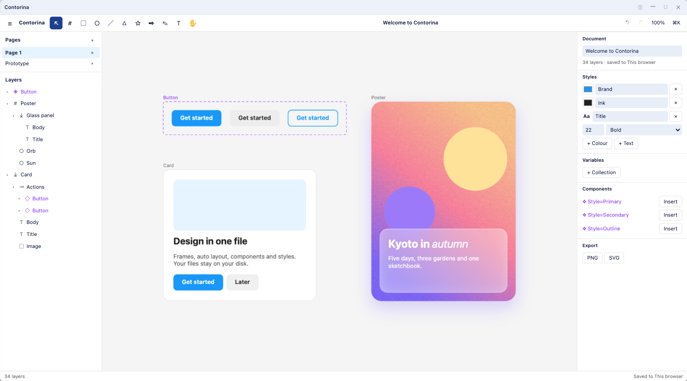
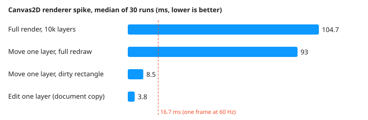

<h1 align="center">Contorina</h1>

<p align="center"><b>A design tool in one HTML file: frames, auto layout, components, vectors, variables and prototypes, saved as plain JSON on your own disk.</b></p>

<p align="center">One HTML file runs in any modern browser and inside NakliOS. It has no account, no server and no telemetry.</p>

<p align="center">


</p>

<p align="center"></p>

## Install

| Where | How |
|---|---|
| On the web | Open `https://contorina.naklitechie.com` (not deployed yet). |
| From disk | Download `index.html` and open it in Chrome, Edge, Firefox or Safari. |
| In NakliOS | Open Contorina from the app catalog once it is listed; documents save to your Folder or Crate. |
| From source | `npm install && npm run build`, then serve the folder and open `index.html`. |

The first visit opens a starter document with a component, two instances and an auto-layout card. Press **⌘K** (Ctrl+K) to search every command, or **?** for the shortcut list. Your working copy saves itself one second after each change; **⌘S** saves a `.contorina.json` file wherever you choose. To drive Contorina from the browser console or an agent:

```js
contorina.commands()                       // every command with its parameters and scope
contorina.run('node.create', { type: 'frame', x: 0, y: 0, w: 320, h: 200 })
contorina.run('export.svg', {})            // returns the SVG as a string
```

## Why

You want to design a screen, keep a component library and hand someone code or a PDF, and you do not want an account, a subscription or a file that only opens in someone else's cloud. Contorina keeps the document as readable JSON on your disk and runs entirely in the page. It has frames with auto layout (row, column, wrap, grid), constraints, components with variants and properties, colour, text and effect styles, variables with modes, the pen and booleans, gradients, images, shadows and blurs, mixed text styles, prototypes with Smart Animate, pages and an inspect mode. It imports SVG and Figma REST JSON and exports PNG, JPG, WebP, SVG, PDF, Android XML, HTML/CSS and React. Live collaboration, plugins, comments and `.fig` files are not built; `plan/research/parity-figcraft.md` lists every gap.

Contorina ports the architecture of [storytold/figcraft](https://github.com/storytold/figcraft) (one command registry, a persistent document model, instances materialised from their mains) and uses the browser's own canvas, text shaping and accessibility tree in place of FigCraft's Rust renderer and UI.

## Results

<p align="center"></p>

A full Canvas2D render of 10,000 layers takes 104.7 ms (median of 30) on an M4 Pro at 2x density, and redrawing only the moved layer's rectangle takes 8.5 ms against 93 ms for a full redraw. These are observed timings, not a benchmark. Reproduce them by serving the folder and opening `spike/renderer-spike.html`; the raw numbers are in `spike/result-2026-11-11.json`, and `node scripts/spike-chart.mjs` redraws the chart.

## Working with components

Select a frame and press **⌘⌥K** to make it a main component; **⌘⌥I** places an instance beside it. Edits to the main reach every instance, and a change you make inside an instance (text, colour, visibility) stays as an override until you press Reset. Name several mains `State=Default`, `State=Hover` and choose **Combine as variants**; each instance then shows a menu for every variant property. Add text, boolean or instance-swap properties on the main, and each instance gets its own field for them.

## Prototyping and handoff

Give a layer an interaction in the Prototype section (navigate, overlay, back or link, with Smart Animate or a slide), then press **⌥⌘Enter** to present. **Shift+D** switches the panel to inspect mode, which shows measurements and CSS, and **⌥⌘C** opens the code for the selection as HTML/CSS or React.

## Where your files live

Standalone, the working copy lives in this browser's storage and **⌘S** writes a file through your browser's file picker. Inside NakliOS, Contorina saves to `apps/contorina/` on the storage you connected, and Folder and Crate keep separate documents.

## Commands

```text
npm run build     # assemble index.html and commands.json from src/
npm test          # Node tests for the document model, layout, components, styles and export
npm run check     # build, test, and confirm the vendored NakliOS SDK matches the canonical copy
node scripts/vendor-naklios-sdk.mjs --file src/shell.html   # refresh the inlined SDK
```

Every menu item, shortcut and palette entry runs a command from one registry. The same registry is `window.contorina` in the page and registers on the NakliOS common rail through `naklios.experimental_commands`; `commands.json` lists the document commands for NakliOS while Contorina is closed.

## Verify it yourself

```text
npm run check
```

The check fails if the build breaks, if any of the 68 Node tests fails, or if the inlined SDK differs from `https://naklios.dev/sdk/naklios.js`; CI also fails when `index.html` or `commands.json` differs from a fresh build. Ten of the tests feed hostile documents, SVG files and agent calls (script injection, endless loops, structure rewrites). The editor core was driven with real input in Chrome on 2026-11-11, and layers 3 to 5 with synthetic events in the page; those drives are not committed tests.

## License

MIT, see `LICENSE`. Ported ideas from FigCraft (MIT OR Apache-2.0) and the inlined NakliOS SDK (MIT) are credited in `NOTICE`.

Plan and decisions: `plan/` (not in git) · study of FigCraft: `plan/research/figcraft-study.md`
